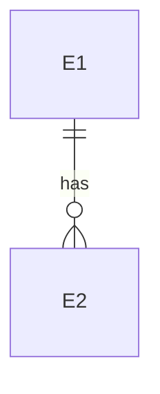

# Data template

Aim for roughly 1,500-3,000 words. Tables over prose. Sections in this order; drop one only if irrelevant and say so in one line. No tables/indexes/DDL, no owning parts (B-n), products only where a requirement fixes them.

````markdown
# <Name> — Data

> **Links:** [concept](concept.md) · [requirements](requirements.md) · [resource-math](resource-math.md) · [contracts](contracts.md) · [decisions](decisions.md)
> **Status:** draft / agreed (agreed only when the clarity gate passes, SKILL.md step 5) · **Date:** <date> · **Based on:** requirements.md (<date>), resource-math.md (<date>), contracts.md (<date>)
> **Counts:** <n> E · <n> M   (the checker compares these with the tables)

## 1. Summary
The data in ≤5 sentences: how many entities, which storage classes, the biggest volume driver, the longest copy chain, the main finding.

## 2. Entity catalog
| ID | Entity | Meaning | Writers (actors) | Volume | Growth | Retention | Storage class | Sensitivity | Needs | Serves |
|---|---|---|---|---|---|---|---|---|---|---|
| E-1 | Action journal | every external action with its result | agents, owner | ~2 KB × A-7 per goal (A-3 goals/month) | A-3 × A-7 × 2 KB/month | 12 months | append-only log | personal | append-only, read by task | FR-17, NFR-9 |

`Volume`/`Growth`: a figure with its unit or the resource-math assumption `A-n` it comes from. `Storage class`: relational / document / file-blob / log / queue / cache / memory / flash / register. `Sensitivity`: public / internal / personal / secret. `Needs`: transaction with E-m, read-mostly, append-only, latency budget L-n, ...

## 3. Relations

Nodes are the catalog ids written `E1`, `E2`. One line per relation below the diagram only where the meaning is not obvious (cardinality, invariants such as "action key unique per task").

## 4. Lifecycle and copies
| ID | Created by | Changed by | Deleted by / when | Copies (backups, caches, replicas, derived data, logs, provider side) | Copy lifetime |
|---|---|---|---|---|---|
| E-1 | agent via gateway | never (append-only) | owner on request; automatic after retention | nightly backup; log excerpt in monitoring | 14 days; 7 days |

The longest chain of copies, computed against the deletion and retention requirements (e.g. 14 + 7 = 21 ≤ 30).

## 5. Memory strategy
For in-process and embedded systems (otherwise write "not applicable: <reason>"):
| ID | Region | Contents | Lifetime | Size | Allocation | On exhaustion | Serves / limit |
|---|---|---|---|---|---|---|---|
| M-1 | audio ring | output samples | process | 2 × 32 frames × 4 B | static | drop and count | NFR-1, L-2 |

## 6. Storage classes and totals
Per class: the entities in it, why this class (access pattern, consistency, cost), the total volume and growth against the resource-math limits.

## 7. Findings and consequences
Requirement issues found (history vs deletion, speed vs consistency, retention vs cost) with the decision taken or pending. Constraints for the architecture, tagged `→ architecture: …`, `→ mechanics: …`, `→ resilience: …`.

## 8. Risks, assumptions and open questions
Ranked; every assumed volume or retention has the cheapest way to validate.

## 9. Consistency check
Date; `check_data.py` result (errors / warnings left and why); verdict of the independent reviewer; what was fixed; what stays open.

## Sources
Numbered URLs; delegated findings link to `[R-n]` reports with their confidence.
````
